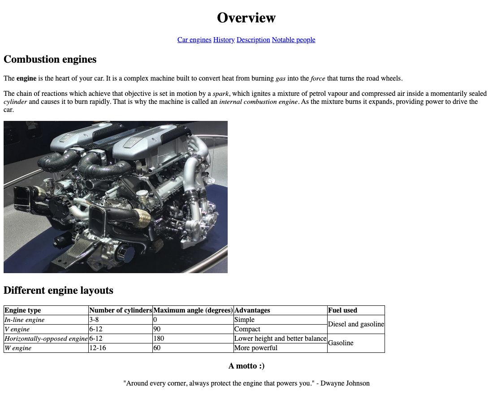

# Combustion Engines - Vanilla HTML Website

A four-page informational website about internal combustion engines, written in **plain ("vanilla") HTML** with a single, minimal stylesheet: no frameworks, no JavaScript, no build step. It focuses on semantic markup and core HTML elements: tables, nested lists, collapsible sections and embedded media.



## Pages

| Page | Content |
| --- | --- |
| [Overview](index.html) | What a combustion engine is, plus a comparison table of in-line, V, horizontally-opposed and W engine layouts |
| [History](history.html) | From Otto's four-stroke engine (1876) and the Benz Patent-Motorwagen to the Model T, V8 engines and fuel injection, followed by a nested timeline |
| [Description](description.html) | Main engine components, spark vs. compression ignition, the operating cycle and an embedded animation of how an engine works |
| [Notable people](people.html) | Karl Benz, Henry Ford, Rudolf Diesel, Gottlieb Daimler and Wilhelm Maybach, with portraits, inventions and links to Wikipedia |

## HTML and CSS techniques

- **Semantic HTML5 structure** on every page: `header`, `nav`, `main`, `section` and `footer`, with a shared navigation bar.
- **Tables**: merged cells with `rowspan` on the engine layouts table, and tables nested inside table cells on the Notable people page.
- **Nested ordered lists** (up to four levels) for the history timeline.
- **Collapsible content** with the native `<details>` / `<summary>` elements, without any JavaScript.
- **Embedded media**: an HTML5 `<video>` player with controls and a fallback message, a modern AVIF image, and JPEG photos with descriptive `alt` text.
- **Heading hierarchy** from `h1` to `h5` to structure the technical description.
- **One shared stylesheet** (`css/styles.css`) that centers the header and footer and draws collapsed table borders.

## Project structure

```
VanillaWebsite/
├── index.html           # Overview (home page)
├── history.html         # History and timeline
├── description.html     # How an engine works
├── people.html          # Notable people
├── css/
│   └── styles.css       # Shared stylesheet
├── images/              # Engine photos, portraits and the README screenshot
└── media/
    └── engine-animation.mp4
```

## Running locally

No installation is needed. Open `index.html` in a browser, or serve the folder with any static server:

```bash
git clone https://github.com/armandursei/VanillaWebsite.git
cd VanillaWebsite
python3 -m http.server 8000
# then open http://localhost:8000
```

## See also

[StyledWebsite](https://github.com/armandursei/StyledWebsite) is a separate project on the same topic, built as a responsive site with Flexbox, CSS Grid and a CSS-only menu.

## Author

George-Armand Ursei - [GitHub](https://github.com/armandursei)
